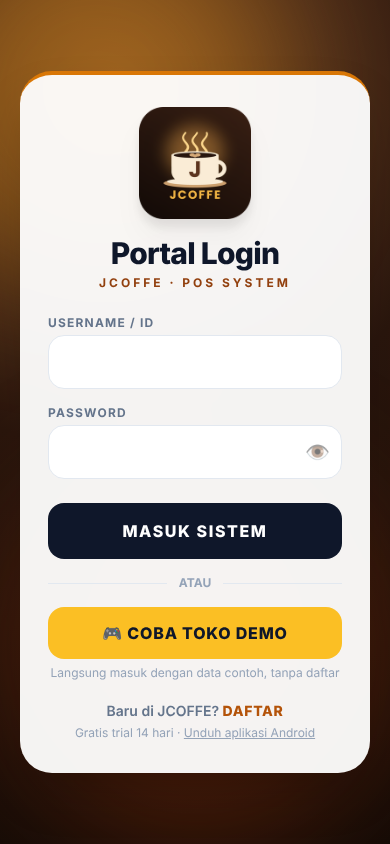
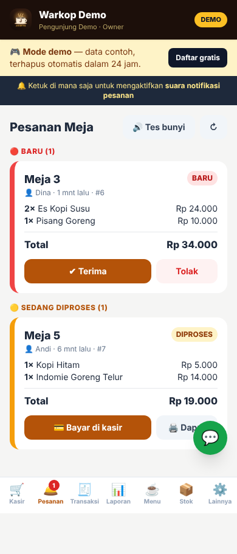
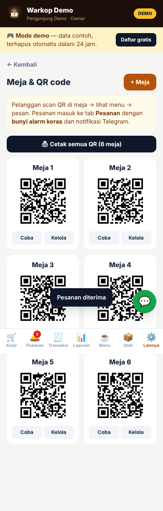
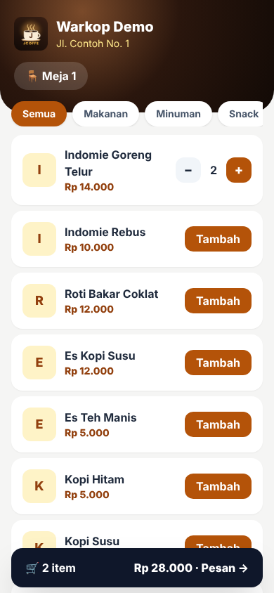

<div align="center">
  
  <h1>JCOFFE POS — Aplikasi Kasir Coffee Shop & Warkop</h1>
  <p><i>Kasir cepat · pesan lewat QR meja dengan alarm · resep potong stok otomatis · cetak struk Bluetooth · laporan laba rugi · bot Telegram</i></p>

  []()
  [](https://github.com/muchlis7771-svg/Aplikasi-Kasir-POS-Gratis-.apk/raw/jcoffe-pos/apk/JCOFFE-POS.apk)
  [](https://warkop-rafli.muchlis7771.workers.dev/promo)
</div>

---

## 📥 Unduh

### 👉 [ 📲 DOWNLOAD APK JCOFFE POS v3 ](https://github.com/muchlis7771-svg/Aplikasi-Kasir-POS-Gratis-.apk/raw/jcoffe-pos/apk/JCOFFE-POS.apk) 👈

- 🌐 Halaman promo: **https://warkop-rafli.muchlis7771.workers.dev/promo**
- 💻 Versi web: **https://warkop-rafli.muchlis7771.workers.dev** (bisa langsung **🎮 Coba Toko Demo** tanpa daftar)

Cara pasang: unduh APK → buka → **Instal**. Kalau ada versi baru, aplikasi menampilkan tombol **Update** dan mengarah ke file di atas.

## ✨ Fitur

| | |
|---|---|
| 🛒 **Kasir** | Kategori, cari menu, promo & diskon, Tunai/QRIS/Transfer/Debit, kembalian otomatis |
| 🪑 **QR meja** | Owner/admin membuat QR tiap meja, cetak A4 siap tempel. Pelanggan scan → pilih menu → pesan |
| 🔊 **Alarm pesanan** | Sirene keras + getar + suara "Pesanan baru, Meja 3" di dashboard kasir + notifikasi Telegram |
| 🖨️ **Cetak lengkap** | Thermal Bluetooth (RawBT), BLE langsung (Chrome), printer PC/USB 58/80 mm, nota A4, order dapur, ringkasan laporan, struk digital via WhatsApp, cetak otomatis |
| 🧪 **Resep wajib** | Menu tidak bisa dibuat sebelum resep diisi — stok terpotong otomatis, HPP & margin akurat |
| 👥 **Role & hak akses** | Owner, Operational Manager, Admin, Supervisor, Kasir/Barista — hak akses tiap role bisa diatur owner |
| ⏰ **Trial 14 hari** | Setelah habis, toko tetap bisa **bertransaksi**; fitur lain terkunci sampai diperpanjang |
| 💬 **Chat Head Admin** | Keluhan/bantuan/perpanjang langsung ke WhatsApp Head Admin (0813-4064-173), tercatat di dashboard |
| 🛡️ **Dashboard Head Admin** | Semua toko & user, status trial, perpanjang/blokir, pesan masuk, pengaturan update APK |
| 🤖 **Bot Telegram** | Notifikasi transaksi & pesanan, laporan harian 21:00 WITA, `/omzet` `/laris` `/stok` |

<p>
   
</p>

## 🛠️ Untuk developer

```
jcoffe/
  src/server.js     API, auth, trial, Telegram, Head Admin, demo
  src/features.js   role & hak akses, meja/QR, pesanan, chat admin, struk publik, versi APK
  src/frontend.js   semua halaman (login, kasir, admin, pesan pelanggan, cetak QR, promo)
  worker.js         hasil build satu file (ini yang dideploy)
  wrangler.toml     worker "warkop-rafli", D1 binding DB → warkop_rafli_db
apk/JCOFFE-POS.apk  APK terbaru (dipakai fitur Update di aplikasi)
apk-builder/        pembuat APK WebView (tanpa Android SDK) + verifikasi tanda tangan v2
```

- **Deploy otomatis:** setiap push ke branch `jcoffe-pos` yang mengubah `jcoffe/**` menjalankan workflow **Deploy JCOFFE POS** (secret `CLOUDFLARE_API_TOKEN`).
- **Build ulang:** `cd jcoffe && npm i && sh build.sh` → menghasilkan `worker.js`.
- **Rilis APK baru:** naikkan `VERSION_CODE` di `apk-builder/build_apk.py`, build dengan kunci tanda tangan yang sama (tidak disimpan di repo), ganti `apk/JCOFFE-POS.apk`, lalu naikkan `APK_VERSION` di `src/features.js` (atau isi di Dashboard Head Admin → Pengaturan → Update aplikasi).

---
*© 2026 JCOFFE POS · J-DATA Digital Solution*
